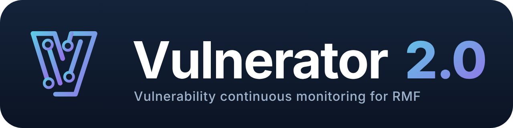



    
    <h3>Vulnerability and STIG data consolidation for DoD RMF and eMASS</h3>
    

        <a href="https://github.com/hbonesctr/Vulnerator/releases/latest"><b>Download the latest release</b></a> &middot;
        <a href="https://hbonesctr.github.io/Vulnerator/">Project page</a> &middot;
        <a href="docs/release-notes">Release notes</a> &middot;
        <a href="https://github.com/hbonesctr/Vulnerator/issues">Issues</a>
    

Vulnerator 2.0 is a maintained rewrite of [Vulnerator](https://github.com/Vulnerator/Vulnerator). It brings the tool to
NIST SP 800-53 Rev 5, current DISA checklist and scan formats, and eMASS POA&M and hardware / software exports, and it
runs offline on hardened DoD workstations without administrator rights.

## Get started

1. Download `Vulnerator-<version>.zip` from [Releases](https://github.com/hbonesctr/Vulnerator/releases/latest) and
   check its SHA-256 against the release page: `Get-FileHash .\Vulnerator-<version>.zip`.
2. If Windows marks the zip as downloaded from the internet, right-click it > **Properties** > **Unblock**, then extract
   it. **Extract all of the files.**
3. Run `Vulnerator.exe` from inside the folder (desktop shortcut: right-click > **Send to** > **Desktop (create
   shortcut)**).
4. Choose **Portable** (database next to the program) or **Persistent** (a database file you pick), then complete the
   one-time setup under **Settings**: your details, eMASS export values and marking, the DISA STIG library and your
   eMASS IG/AP export.

**Requirements:** 64-bit Windows, .NET Framework 4.8. No installation, no administrator rights. The database engine is
`winsqlite3.dll` (part of Windows), and the program runs with .NET strong-name bypass disabled. Nothing contacts the
internet unless you turn on Settings > Online Checks. The program's **Help** page covers setup, importing, findings,
reports and the log.

## What it does

| | |
| :-- | :-- |
| **Imports** | STIG checklists (.ckl, STIG Viewer 3 .cklb, Evaluate-STIG output - older results in *Previous* folders skipped); ACAS / Nessus (.nessus, CSV) from files, zips or folders of zips; SCAP / SCC XCCDF results; the DISA STIG library |
| **NIST SP 800-53 Rev 5** | Findings mapped to CCIs and Rev 5 controls (DISA CCI list, CNSSI 1253 baselines); eMASS assessment procedures from your own IG/AP export |
| **Reports** | eMASS POA&M and Hardware / Software workbooks, STIG Details, PDF Summary, Risk Assessment Report, SCAP & STIG Discrepancies, Ports, Protocols & Services, per-host STIG checklists |
| **Handling** | Classification / handling marking on every export; labeled input files imported only after you confirm the label |
| **Configuration Management** | Hardware, software, groups and ports, protocols and services |
| **Dashboards** (free add-on, included) | Offline charts: open findings by severity, top hosts, compliance by control family, POA&M aging, trend, coverage gaps, outdated STIG checklists, active IAVMs |

## In the release zip

`Vulnerator.exe` and its libraries, `LICENSE.txt`, `THIRD-PARTY-NOTICES.txt`, the free Dashboards add-on in
`Add-ons\Dashboards`, and `Test-RealData.ps1`, which imports a
folder of your own files into a throwaway database and prints one line per file (nothing leaves your machine). Each
release also carries the zip's SHA-256 and a per-file hash list for application allow-listing.

## Building

There is no local development environment: builds and tests run in GitHub Actions on Windows
([.github/workflows/build.yml](.github/workflows/build.yml)) - reference-data and SQL checks, the Release build, a
launch test with strong-name bypass disabled, end-to-end import / export / edit tests on synthetic files, and eMASS
template checks. Pushing a `release/v*` branch (or a `v*` tag) publishes that release. Reference data is regenerated
with the scripts in [tools/rev5](tools/rev5). The project page is [docs/index.html](docs/index.html) (GitHub Pages).

## Credits and license

Vulnerator 2.0 application rewrite: **Hector L. Bones**. Based on Vulnerator by Alex Kuchta, Jeff Vanerwegen, Rick
Murphy, Jeff Purcell and contributors. MIT License (see [LICENSE](LICENSE)); bundled components are listed in
`THIRD-PARTY-NOTICES.txt` in each release. The Dashboards add-on (`tools/addons/Dashboards`, shipped in
`Add-ons\Dashboards`) is free but closed-source and not MIT-licensed; see its
[LICENSE.txt](tools/addons/Dashboards/LICENSE.txt).
